- [中文](README.md)
- [English](README_EN.md)

# 睫毛外设 (Eyelash Peripherals) Corne ZMK 仓库

**该键盘与 [foostan's Corne](https://github.com/foostan/crkbd) 不同，无法与标准的 `corne` 固件兼容。**

如果您需要该键盘的 3D 模型，请发送电子邮件至 `380465425@qq.com`。

## 使用说明

1. [叉取此仓库](https://docs.github.com/en/get-started/quickstart/fork-a-repo#forking-a-repository)。
2. [点击 **Actions** 选项卡，确保工作流已启用](https://docs.github.com/en/actions/managing-workflow-runs-and-deployments/managing-workflow-runs/disabling-and-enabling-a-workflow#enabling-a-workflow)。
3. 确保 [`config/west.yml`](config/west.yml) 中的 `eyelash_corne` 项目仍然有效。`boards/arm/eyelash_corne` 文件夹将从此 URL 下载。
4. 如果您的叉取中仍存在 `boards/arm/eyelash_corne` 文件夹，请将其删除。

**如果您已经有 ZMK 配置仓库，[您可以将此作为模块添加，而不是叉取](https://zmk.dev/docs/features/modules#building-with-modules)。**

## 从 RMK 切回 ZMK

RMK 会占用 ZMK 为 SoftDevice 保留的 flash 区。如果这块板子刷过 RMK，之后再
刷默认（保留 SoftDevice）的 ZMK 会**启动不了**（没有 USB、没有蓝牙），但
bootloader 仍能进入。

本仓库的 `build.yaml` 已给左半、右半和 `settings_reset` 都加上了
`nrf52840-nosd` snippet：它会去掉 SoftDevice 预留，把 app 链到 `0x1000`
（与 RMK 相同）。刷机时每一半先刷 `settings_reset`，再刷正式固件即可。

除非用 SWD 重刷带 SoftDevice 的 bootloader，否则以后所有 ZMK 构建都要保留
`nrf52840-nosd`。参考 RMK FAQ「ZMK no longer works after flashing RMK」
（issue #799）。

## Corne 键位图

